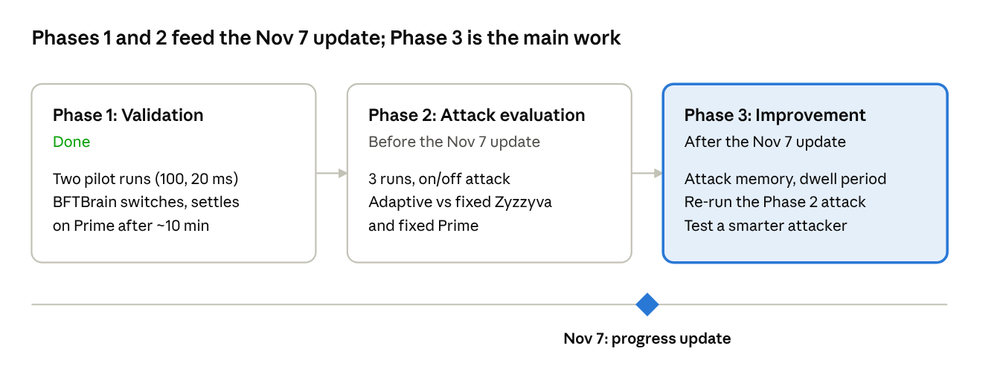

# Adaptive BFT: Intermediate Progress Report

Nov 4, 2026 · @Rongjian Wang

> Snapshot of the live report: https://claude.ai/artifact/NQPf8dNXFvP1RhxtqS45sG (the live version may be newer).

## Summary

We have BFTBrain running end to end on a single machine and have validated its behavior under a slow-leader attack. Under a 20 ms proposal-delay attack, BFTBrain eventually settles on the right protocol (Prime), but only after about 10 minutes of re-exploration, during which throughput is roughly one fifth of Prime's.

This adaptation lag, not a permanent wrong choice, is the weakness we will target. The project now follows three phases: (1) validation, done; (2) a short attack evaluation that quantifies the lag against fixed-protocol baselines; and (3) the main contribution, defenses that shorten or remove it.

## Roadmap

Phase 1 is complete and Phase 2 is a short, three-run experiment for the Nov 7 update; most of the remaining time goes to Phase 3.

## Experimental setup

All runs so far use the public [BFTBrain code base](https://github.com/JeffersonQin/BFTBrain) on one laptop (Apple M4 Pro, 12 cores, 48 GB), with small local fixes and no change to the protocols or the learning algorithm.

| Item | Setting |
| --- | --- |
| Replicas | 4 (f = 1), plus 1 client and 1 coordinator, all on localhost |
| Malicious replica | Replica 0, the stable leader in PBFT, Zyzzyva, CheapBFT, SBFT and Prime |
| Protocol pool | PBFT, Zyzzyva, CheapBFT, SBFT, HotStuff, Prime (BFTBrain default) |
| Learning | BFTBrain default: per-transition random forests with bootstrap sampling, epoch = 1,000 sequence numbers |
| Workload | Paper's row-1 setting: 4 KB requests, closed loop, 100 clients |
| Attack | BFTBrain's built-in slow-proposal fault: the leader delays each proposal; Prime ignores it by design |

Local fixes: a race in the learning agent's start-up (agents crashed when started at the same moment on one host), local heap size and JDK path, and a script that runs one unattended experiment and collects its logs.

## Phase 1 results: validation

BFTBrain does react to the attack and eventually picks the best protocol, but the adaptation takes about 10 minutes. Both pilots are single, qualitative runs: learning enabled, no attack at first, then a constant attack until the end.

Pilot 2 (20 ms delay, attack from 180 s, 800 s total):

| Time | What BFTBrain did | Throughput (req/s) |
| --- | --- | --- |
| 0–60 s | Explored all six protocols | \~13,800 |
| 60–180 s | Settled on Zyzzyva | \~19,000–20,000 |
| 180–660 s | Attack on; tried PBFT, SBFT, CheapBFT, Zyzzyva and HotStuff in turn | \~700–1,300 |
| 660–765 s | Alternated: Prime, then another protocol, back to Prime | \~1,300–2,600 |
| 765–800 s | Stayed on Prime | \~4,600 |

Throughput per protocol while under attack (pilot 2):

| Protocol | Avg throughput (req/s) | Why |
| --- | --- | --- |
| Prime | 4,628 | Attack has no effect |
| HotStuff | 2,791 | Rotating leader: replica 0 leads about 1/4 of the time |
| Zyzzyva | 866 | Replica 0 is always the leader |
| CheapBFT | 805 | Same |
| SBFT | 798 | Same |
| PBFT | 764 | Same |

Pilot 1 (100 ms delay) gave the same picture with a stronger attack: stable-leader protocols fell from \~20,000 to \~190 req/s. Because an epoch is a fixed number of requests, each attacked epoch lasted \~53 s, so BFTBrain made only 10 decisions in 6.5 minutes; it reached Prime once and left after one epoch.

What we learned:

1. BFTBrain switches under attack and, given enough epochs, converges to the right protocol.
2. Convergence is slow because it first tries every untried (previous → next) protocol pair, and each try costs a full attacked epoch.
3. Under Prime the measured proposal slowness is 0, so the state looks attack-free; this is why it keeps trying to leave Prime until every exit has been tried once.
4. Epochs defined by request count stretch under attack, which slows decisions exactly when they matter.
5. Locally, even 20 ms cuts stable-leader throughput \~25x; Phase 2 will use smaller delays as well.

## Phase 2: attack evaluation

Phase 2 is deliberately small: three runs, no new attack code, to measure how much the adaptation lag costs when the attack keeps turning on and off. Results will be added here.

Attack: the same slow-proposal fault, on for 3 minutes and off for 3 minutes, repeated over a \~15-minute run.

| Run | System | Role |
| --- | --- | --- |
| 1 | BFTBrain (adaptive) | System under test |
| 2 | Fixed Zyzzyva | Fastest protocol without attack |
| 3 | Fixed Prime | Immune to the attack, slower without it |

Metrics:

- Average throughput over the whole run, adaptive vs. each fixed protocol
- Time to settle after each attack onset and each attack end
- Number of protocol switches

Expected outcome: each on/off transition forces BFTBrain to re-adapt, so it may do worse overall than one or both fixed protocols. Whatever the result, these numbers become the baseline that Phase 3 must improve on.

Results: to be added after the runs.

## Phase 3: improving BFTBrain

Phase 3 is the main contribution: we will first implement attack memory and a dwell period, the two low-cost defenses aimed directly at what Phase 1 showed, then evaluate them under the Phase 2 attack.

| Weakness seen in Phase 1 | Proposed defense | Effort | Priority |
| --- | --- | --- | --- |
| Under Prime the attack is invisible, so the state looks normal and BFTBrain tries to leave | Attack memory: add a feature such as the maximum proposal slowness seen in the last N epochs | Low | First |
| Repeated switching between Prime and vulnerable protocols | Dwell period (as in BFTide): after an attack-driven switch, stay at least k epochs; double k after a rapid re-switch | Low | First |
| Forced exploration of every untried protocol pair while under attack | Safe exploration: when an attack is detected, explore only pairs whose predicted loss is small | Medium | If time allows |
| Epochs stretch under attack, so decisions slow down | Time-based epochs, or a cap on epoch duration | Low–medium | If time allows |

Evaluation:

1. Same on/off attack as Phase 2: original vs. improved BFTBrain on settling time, average throughput and switch count.
2. No-attack run: the improved version must not lose normal-case throughput.
3. Smarter attacker: a protocol-aware attacker that only attacks when the system leaves Prime, or waits out the dwell period, to check the defense still holds when the attacker knows about it.

## Scope changes from the proposal

The focus has moved from searching for the strongest attack to fixing the weakness the pilots exposed.

| Proposal | Now |
| --- | --- |
| Automated search over a family of protocol-aware attack rules | Dropped for now; Phase 2 uses one simple on/off attack |
| Protocol-aware attacker as the main subject | Kept as a stress test for the Phase 3 defenses |
| Mitigation only if an effect is found | Mitigation is the main contribution (Phase 3) |
| Reduced protocol pool | Full six-protocol pool, BFTBrain default |
| Multi-machine cluster | Single machine for now; key runs repeated on a cluster if one is available |

## Limitations and open questions

The Phase 1 findings are qualitative: each pilot is one run on one machine.

- Single machine: no real network delay, and six processes share the CPU, so absolute numbers are not comparable to the paper's.
- Attack strength: locally even 20 ms is severe; we will add smaller delays (a few ms).
- No view change: BFTBrain's configs disable leader replacement, so a slow leader is never removed. The attack delay should stay below a realistic timeout.
- Open: how much of the lag comes from forced exploration vs. from the attack-free state under Prime? The two Phase 3 defenses test each cause separately.
- Open: access to a cluster (e.g., CloudLab) for the final runs.

## References

1. Wu, C., et al. BFTBrain: Adaptive BFT Consensus with Reinforcement Learning. NSDI 2025. [arXiv 2408.06432](https://arxiv.org/html/2408.06432)
2. Bhujel, S., et al. Adaptive Switching Between Leader-Based and Leaderless BFT Protocols (BFTide). Preprint, 2026. [arXiv 2609.31388](https://arxiv.org/html/2609.31388)
3. BFTBrain source code. [GitHub](https://github.com/JeffersonQin/BFTBrain)
