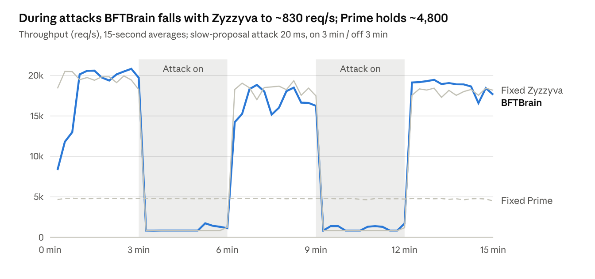

# Adaptive BFT: Intermediate Progress Report

Nov 6, 2026 · Jay Wang, David Jiang

> PDF: `progress-report-2026-11.pdf`. Snapshot of the live report: https://claude.ai/artifact/NQPf8dNXFvP1RhxtqS45sG (the live version may be newer).

## Summary

An attacker that changes its behavior faster than BFTBrain can adapt makes this learning-based BFT system lose its advantage entirely. Phases 1 and 2 (validation and attack evaluation) are done; Phase 3, defenses that make online adaptation robust, is next.

## Motivation and story

**The problem.** BFT consensus lets a group of servers agree on the order of transactions even when some of them are malicious. Many BFT protocols exist, and none is best everywhere: some are fastest when every server behaves, others stay stable when the leader is slow. Adaptive systems such as BFTBrain therefore learn at run time which protocol suits current conditions, and switch to it.

**The hidden assumption.** BFTBrain's learner treats conditions as something that changes slowly and on its own, regardless of which protocol it picks. A malicious server breaks both halves: it can change its behavior whenever it likes, and it always knows which protocol is running.

**What we expected.** Our proposal assumed a "bait-and-stay" attack: with a small budget, the attacker pushes BFTBrain off its best protocol and then stops, while BFTBrain stays on a worse protocol. Under equal attack budgets, the adaptive system would then do worse than a fixed one.

**What we found.** BFTBrain does not stay. It decides from the currently measured state, so once an attack stops it returns to the best protocol within seconds, and the bait-and-stay attack has nothing to hold on to. Its real weakness is the opposite: it is slow to adapt *to* an attack, taking about 10 minutes of trial and error to settle on the right protocol. An attacker that switches on and off faster than that is never adapted to: during attacks BFTBrain performs like an attacked Zyzzyva, and overall it is no better than simply fixing Zyzzyva. Adaptation neither hurts nor helps; its benefit is cancelled.

**What we will do.** The weakness is the adaptation lag itself. Our main contribution will be to make online adaptation faster and harder to mislead, while keeping its ability to learn (unlike BFTide, which replaces online learning with an offline-trained policy). This should help against attackers and also whenever conditions change quickly.

In one sentence: a learning-based protocol selector can be exploited through how slowly it adapts, and we aim to fix that.

## Roadmap

Phase 1 is complete and Phase 2 is a short, three-run experiment for the Nov 7 update; most of the remaining time goes to Phase 3.

## Key results

1. **BFTBrain adapts, but slowly.** Under a constant slow-leader attack it eventually settles on Prime, the only protocol the attack cannot slow down, after about 10 minutes; in the meantime its throughput is about one fifth of Prime's. Three design choices cause the lag: it must try every untried protocol transition once, the attack is invisible while Prime runs, and decisions slow down when the system is slow (Appendix B).
2. **A simple on/off attacker removes the benefit of adapting.** With the attack on for 3 minutes and off for 3, BFTBrain never reaches Prime during an attack. It averages 10,930 req/s: the same as always running Zyzzyva (10,904), and 13% below an ideal switcher (~12,600) that would use Prime only during attacks (Appendix C).

## Next steps (Phase 3): improving BFTBrain

Next, we will build the main contribution: defenses that make the online learner itself robust, compared against BFTide's switching damping as a baseline, under the Phase 2 attack. We start with attack memory, then safe exploration.

| Weakness seen in Phase 1 | Defense | Role | Priority |
| --- | --- | --- | --- |
| Under Prime the attack is invisible, so the state looks normal and BFTBrain tries to leave | Attack memory: add a feature such as the maximum proposal slowness seen in the last N epochs | Ours | First |
| Forced exploration of every untried protocol pair while under attack | Safe exploration: when an attack is detected, explore only pairs whose predicted loss is small | Ours | Second |
| Epochs stretch under attack, so decisions slow down | Time-based epochs, or a cap on epoch duration | Ours | If time allows |
| Repeated switching between Prime and vulnerable protocols | Dwell period from BFTide: stay at least k epochs after a switch; double k after a rapid re-switch | Baseline | Planned |

Evaluation:

1. Same on/off attack as Phase 2: original BFTBrain vs. BFTBrain + BFTide-style dwell period vs. BFTBrain + our defenses, on average throughput, throughput during attacks, and switch count. Target: close the 13% gap to the ideal switcher.
2. No-attack run: the improved version must not lose normal-case throughput.
3. A natural fast-changing workload, to show the defenses help beyond attacks.
4. Smarter attacker: a protocol-aware attacker that knows the defense (e.g., waits out the dwell period, or attacks right after the memory window expires).

## References

1. Wu, C., et al. BFTBrain: Adaptive BFT Consensus with Reinforcement Learning. NSDI 2025. [arXiv 2408.06432](https://arxiv.org/html/2408.06432)
2. Bhujel, S., et al. Adaptive Switching Between Leader-Based and Leaderless BFT Protocols (BFTide). Preprint, 2026. [arXiv 2609.31388](https://arxiv.org/html/2609.31388)
3. BFTBrain source code. [GitHub](https://github.com/JeffersonQin/BFTBrain)

# Appendix: details

The sections below give the setup, the full results and the scope changes behind the summary above.

## A. Experimental setup

All runs so far use the public [BFTBrain code base](https://github.com/JeffersonQin/BFTBrain) on one laptop (Apple M4 Pro, 12 cores, 48 GB), with small local fixes and no change to the protocols or the learning algorithm.

| Item | Setting |
| --- | --- |
| Replicas | 4 (f = 1), plus 1 client and 1 coordinator, all on localhost |
| Malicious replica | Replica 0, the stable leader in PBFT, Zyzzyva, CheapBFT, SBFT and Prime |
| Protocol pool | PBFT, Zyzzyva, CheapBFT, SBFT, HotStuff, Prime (BFTBrain default) |
| Learning | BFTBrain default: per-transition random forests with bootstrap sampling, epoch = 1,000 sequence numbers |
| Workload | Paper's row-1 setting: 4 KB requests, closed loop, 100 clients |
| Attack | BFTBrain's built-in slow-proposal fault: the leader delays each proposal; Prime ignores it by design |

Local fixes: a race in the learning agent's start-up (agents crashed when started at the same moment on one host), local heap size and JDK path, and a script that runs one unattended experiment and collects its logs.

Code, configs, raw results and analysis scripts: [our fork, branch attack-pilot](https://github.com/JayWang0902/BFTBrain/tree/attack-pilot) (`LOCAL_SETUP.md` explains how to reproduce a run).

## B. Phase 1 details: validation

BFTBrain does react to the attack and eventually picks the best protocol, but the adaptation takes about 10 minutes. Both pilots are single, qualitative runs: learning enabled, no attack at first, then a constant attack until the end.

Pilot 2 (20 ms delay, attack from 180 s, 800 s total):

| Time | What BFTBrain did | Throughput (req/s) |
| --- | --- | --- |
| 0–60 s | Explored all six protocols | \~13,800 |
| 60–180 s | Settled on Zyzzyva | \~19,000–20,000 |
| 180–660 s | Attack on; tried PBFT, SBFT, CheapBFT, Zyzzyva and HotStuff in turn | \~700–1,300 |
| 660–765 s | Alternated: Prime, then another protocol, back to Prime | \~1,300–2,600 |
| 765–800 s | Stayed on Prime | \~4,600 |

Throughput per protocol while under attack (pilot 2):

| Protocol | Avg throughput (req/s) | Why |
| --- | --- | --- |
| Prime | 4,628 | Attack has no effect |
| HotStuff | 2,791 | Rotating leader: replica 0 leads about 1/4 of the time |
| Zyzzyva | 866 | Replica 0 is always the leader |
| CheapBFT | 805 | Same |
| SBFT | 798 | Same |
| PBFT | 764 | Same |

Pilot 1 (100 ms delay) gave the same picture with a stronger attack: stable-leader protocols fell from \~20,000 to \~190 req/s. Because an epoch is a fixed number of requests, each attacked epoch lasted \~53 s, so BFTBrain made only 10 decisions in 6.5 minutes; it reached Prime once and left after one epoch.

What we learned:

1. BFTBrain switches under attack and, given enough epochs, converges to the right protocol.
2. Convergence is slow because it first tries every untried (previous → next) protocol pair, and each try costs a full attacked epoch.
3. Under Prime the measured proposal slowness is 0, so the state looks attack-free; this is why it keeps trying to leave Prime until every exit has been tried once.
4. Epochs defined by request count stretch under attack, which slows decisions exactly when they matter.
5. Locally, even 20 ms cuts stable-leader throughput \~25x; later experiments will add smaller delays.

## C. Phase 2 details: attack evaluation

Phase 2 is deliberately small: three runs, no new attack code, to measure how much the adaptation lag costs when the attack keeps turning on and off. Results are below.

Attack: the same slow-proposal fault, on for 3 minutes and off for 3 minutes, repeated over a \~15-minute run.

| Run | System | Role |
| --- | --- | --- |
| 1 | BFTBrain (adaptive) | System under test |
| 2 | Fixed Zyzzyva | Fastest protocol without attack |
| 3 | Fixed Prime | Immune to the attack, slower without it |

Metrics:

- Average throughput over the whole run, adaptive vs. each fixed protocol
- Time to settle after each attack onset and each attack end
- Number of protocol switches

These numbers are the baseline that Phase 3 must improve on.

**Results (Nov 4, single runs, 20 ms delay).** BFTBrain gained nothing from adapting: it averaged 10,930 req/s, the same as always running Zyzzyva (10,904), and 13% below an ideal switcher (~12,600) that runs Prime only during attacks.

| Run | Average from 60 s | Off 60–180 s | On 180–360 s | Off 360–540 s | On 540–720 s | Off 720–900 s |
| --- | --- | --- | --- | --- | --- | --- |
| BFTBrain (adaptive) | 10,930 | 20,189 | 1,021 | 16,830 | 1,124 | 18,703 |
| Fixed Zyzzyva | 10,904 | 19,454 | 868 | 18,307 | 862 | 17,995 |
| Fixed Prime | 4,775 | 4,798 | 4,787 | 4,796 | 4,764 | 4,739 |
| Ideal switcher (computed) | ~12,600 | Zyzzyva | Prime | Zyzzyva | Prime | Zyzzyva |

Throughput in req/s, from the coordinator's 3-second samples. The ideal switcher takes the better fixed protocol in each phase. Data: `results/phase2-*`.

- During each 3-minute attack, BFTBrain tried CheapBFT, SBFT, PBFT, HotStuff and Zyzzyva but never settled on Prime, so it ran at ~1,000 req/s while Prime would have given ~4,780.
- After each attack ended it returned to Zyzzyva within seconds, so it lost little in the attack-free phases.
- Net effect: adaptation recovered quickly from attacks but never adapted to them, so it matched the best fixed protocol rather than beating it.
- Prime's throughput is the same with and without the attack (~4,780), confirming the fault is fully disabled under Prime.

A first attempt at the fixed runs disabled checkpoints (to stop switching), which made throughput decay over time; it was discarded and rerun with a one-protocol switching sequence and normal checkpoints.

## D. Scope changes from the proposal

The focus has moved from searching for the strongest attack to fixing the weakness the pilots exposed.

| Proposal | Now |
| --- | --- |
| Automated search over a family of protocol-aware attack rules | Dropped for now; Phase 2 uses one simple on/off attack |
| Protocol-aware attacker as the main subject | Kept as a stress test for the Phase 3 defenses |
| Mitigation only if an effect is found | Mitigation is the main contribution (Phase 3) |
| Reduced protocol pool | Full six-protocol pool, BFTBrain default |
| Multi-machine cluster | Single machine for now; key runs repeated on a cluster if one is available |
| Hypothesis: a bait-and-stay attacker makes adaptive selection worse than a fixed protocol at equal budget | Not supported against BFTBrain: it returns to the best protocol within seconds after an attack stops. Focus moved to its slow adaptation to attacks |

## E. Limitations and open questions

The Phase 1 findings are qualitative: each pilot is one run on one machine.

- Single machine: no real network delay, and six processes share the CPU, so absolute numbers are not comparable to the paper's.
- Attack strength: locally even 20 ms is severe; we will add smaller delays (a few ms).
- No view change: BFTBrain's configs disable leader replacement, so a slow leader is never removed. The attack delay should stay below a realistic timeout.
- Open: how much of the lag comes from forced exploration vs. from the attack-free state under Prime? The two Phase 3 defenses test each cause separately.
- Open: access to a cluster (e.g., CloudLab) for the final runs.
